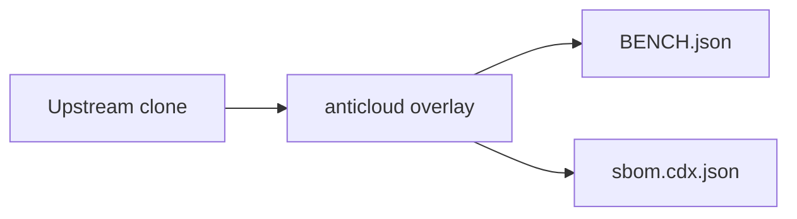

# ASTROBEE — Anticloud overlay

 

Upstream: https://github.com/nasa/astrobee @ bf43a42d5f89bf0679e51ab25e7a9b7800313e9c

## Benchmarks
Benchmarks from BENCH.json: {"schema": "anticloud.tier-bench/1", "project": "ASTROBEE", "source": {"repo_path": "E:\\fenta\\Downloads\\The Anticloud\\ANTICLOUD_REPOS\\SPACE_AEROTECH\\ASTROBEE\\UPSTREAM_CLONE", "git": {"head": "bf43a42d5f89bf0679e51ab25e7a9b7800313e9c", "url": "https://github.com/nasa/astrobee", "branch": "master", "committed_at": "2025-12-02T09:19:13-08:00"}}, "metrics": {"files_total": 2664, "source_files_scanned": 1180, "lines_of_code": 208880, "languages": {".cc": 473, ".h": 462, ".xml": 169, "(none)": 146, ".md": 142, ".msg": 121, ".py": 115, ".txt": 109, ".test": 100, ".config": 99, ".sh": 83, ".lau

Withdrawn claims: anything not in BENCH.json is unmeasured.

## Architecture

## Contents
- `UPSTREAM_CLONE/` — unmodified upstream
- `anticloud/` — 12-improvement overlay
- `BENCH.json`, `sbom.cdx.json` — measured outputs

## Provenance
Tree SHA3-256: 9526141e9ddf55ce20b448fdbe27fc0bc10e7131e5c7fc8f80c4440167b03d08. Chain head: see seal step.

## Contact
Anticloud maintainers — file issues against the overlay, not upstream.
